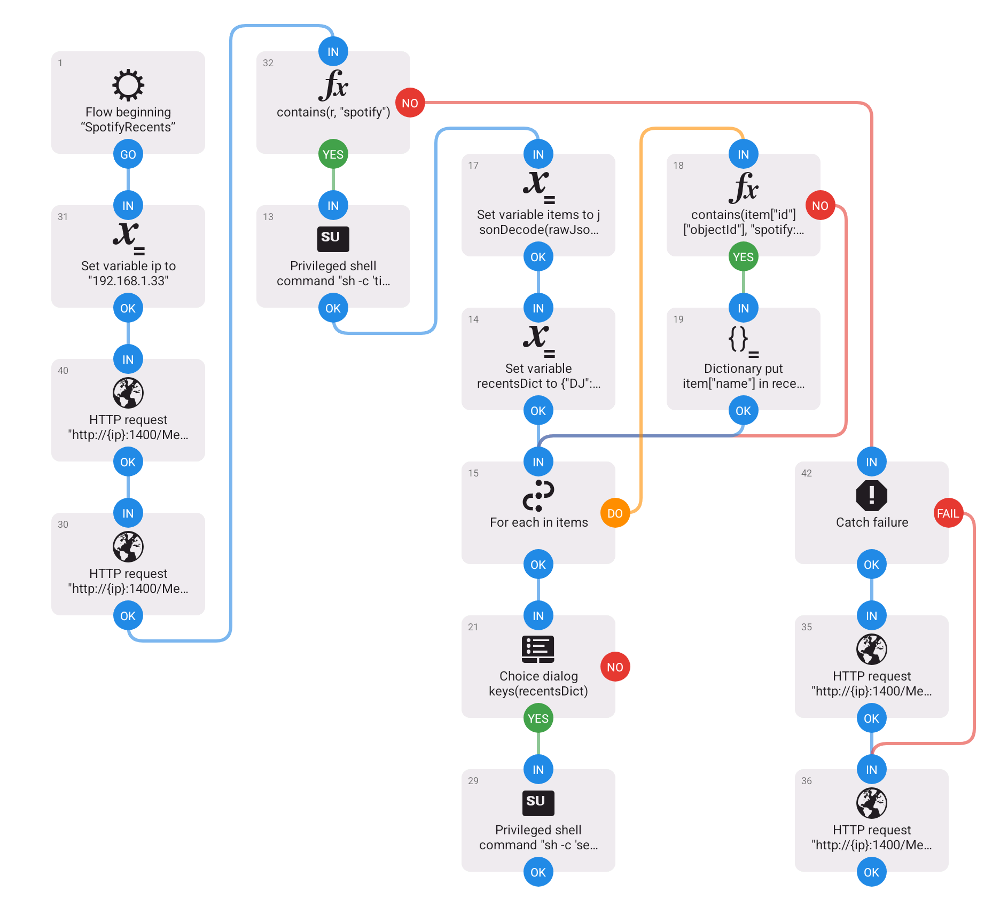

# Sonos-WebSocket-Automate-Flow

Zero-Interruption Audio Switching (Android TV video sources + Sonos music)


The UI Problem

On Android TV, switching music while watching a live video stream normally breaks the viewing experience. Let's instead command Spotify and Sonos while hidden in the background.

The Architecture: Overlay UI + Local WebSocket (websocat)

Instead of switching foreground apps, this workflow keeps video uninterrupted by separating the selection UI from the playback transport:
1. Non-Intrusive Overlay: The sideloaded LlamaLab Automate app overlays a dialog briefly without pausing live video playback.
2. Dynamic Recent History: Automate queries the Sonos speaker's local WebSocket API for recent Spotify items.
3. Direct Speaker Handshake: Once an item is selected, Automate goes behind-the-scenes to pipe a lightweight JSON payload directly to the speaker's local WebSocket endpoint.

Why [websocat](https://github.com/vi/websocat/) Over Full CLI Wrappers

• Self-Contained on Android TV: */data/local/tmp/websocat* is a [single static binary](https://github.com/vi/websocat/releases/download/v1.14.1/websocat.armv7-linux-androideabi) that eliminates the need for an external Linux host, Python environment, or companion server

• Protocol Precision: Talking directly to Sonos's local S2 WebSocket API bypasses legacy UPnP container restrictions like Error 804

# SpotifyRecents


# 1. Flow Logic Summary

Goal: If the Sonos speaker isn't currently playing Spotify, play the previous Spotify state. Otherwise, fetch the user's recent Spotify playlists via WebSocket, let them pick one, and play via WebSocket. Note that simplicity and self-containment preferences usually dictate HTTP Request blocks but for these (Section 4, below) blocks, UPnP is insufficient.

# 2. UPnP HTTP Request blocks (Port 1400)

• Block 40: HTTP: Play — Wakes the speaker and forces active transport

• Block 30: HTTP: GetPositionInfo — Captures a snapshot of the current playback state

• Block 35: HTTP: SetAVTransportURI — Loads the hardcoded Spotify URI (from GetPositionInfo, valid long-term) when falling back or not playing Spotify

• Block 36: HTTP: Play — Plays what's finally ready

# 3. Logic & Decision blocks

• Block 32 (contains(r, "spotify")):
	• YES: Speaker is already on Spotify → fetch recent playlists for user selection
	• NO: Speaker is playing something else (or idle) → skip selection and restore previous Spotify state
  
• Blocks 17–19 (Parse & Filter Loop):
	• Decodes the raw WebSocket JSON, loops through items, filters for spotify: playlist IDs (Block 18), and builds recentsDict (name → id)
  
• Block 21 (Choice Dialog):
	• Displays filtered Spotify playlist names from recentsDict for user selection
  
• Block 42 (Catch Failure):
	• Catches expired sessions or WebSocket/transport errors inconsequential to flow

# 4. WebSocket Shell Command blocks (Port 1443...redacted for GitHub)

• Block 13 (WS CMD #1: Fetch History)
*/data/local/tmp/req.json*
```
[
  {
    "namespace": "history:1",
    "command": "getHistory",
    "householdId": "Sonos_yMwFDy...<REDACTED>",
    "cmdId": "1"
  },
  {}
]
```

• Block 29 (WS CMD #2: Load Selected Playlist): (Injects the user's chosen 22-character Spotify playlist ID)
*/data/local/tmp/djx.json*
```
[
  {
    "namespace": "playback:1",
    "command": "loadContent",
    "householdId": "Sonos_yMwFDy...<REDACTED>",
    "groupId": "RINCON_C...<REDACTED>"
  },
  {
    "type": "playlist",
    "id": {
      "serviceId": "12",
      "objectId": "spotify:playlist:<22_CHAR_PLAYLIST_ID>"
    },
    "playOnCompletion": true
  }
]
```
